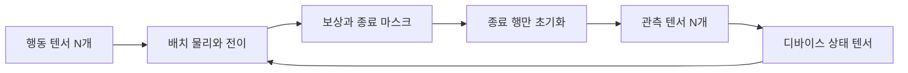

<div align="center">

# GymTosha

**PyTorch 텐서로 배치 전체를 실행하는 강화학습 환경**

[](https://www.python.org/)
[](https://pytorch.org/)
[](LICENSE)
[](https://docs.astral.sh/uv/)
[](https://docs.astral.sh/ruff/)

<a href="https://tenor.com/view/naoya-hair-flip-meme-gif-10753964425195300606">

</a>

투사주법 · 投射呪法 · Tōsha Juhō

[빠른 시작](#빠른-시작) · [지원 환경](#지원-환경) · [성능 검증](#성능-검증) · [API 명세](docs/API.md)

</div>

## 실행 구조

환경 하나씩 실행하는 Python 루프 대신, 상태·행동·보상·종료 여부를 배치 텐서로 계산합니다.
CPU·CUDA·Apple MPS에서 같은 API를 사용하며 전이와 자동 초기화를 함께 컴파일합니다.



## 빠른 시작

새 프로젝트에서 Git URL로 설치할 수 있습니다.

```bash
uv init my-rl-project --python 3.12
cd my-rl-project
uv add "gymtosha @ git+https://github.com/DocyNoah/GymTosha.git@codex/initial-batched-envs"
```

```python
import torch
import gymtosha

device = "cuda" if torch.cuda.is_available() else "cpu"
env = gymtosha.make("CartPole-v1", num_envs=4096, device=device).compile()
obs, info = env.reset(seed=42)

for _ in range(1000):
    actions = torch.randint(2, (env.num_envs,), device=env.device)
    obs, reward, terminated, truncated, info = env.step(actions)

env.close()
```

Apple GPU에서는 `device="mps"`를 지정합니다. 첫 `step`에는 컴파일 시간이 포함될 수 있습니다.
각 환경은 독립적인 난수 상태를 갖고, 환경 생성과 초기화가 정책의 전역 PyTorch 난수를 바꾸지 않습니다.

연속 행동 환경도 같은 방식으로 만듭니다.

```python
env = gymtosha.make("MountainCarContinuous-v0", num_envs=1024, device=device)
obs, _ = env.reset(seed=42)
actions = torch.rand(1024, 1, device=env.device) * 2 - 1
obs, reward, terminated, truncated, info = env.step(actions)
```

## 지원 환경

`N`은 `num_envs`입니다. Box 관측은 float32, 이산 관측은 int64입니다.

| env ID | 관측 shape | 행동 shape | 기본 제한 스텝 |
| --- | --- | --- | --- |
| `CartPole-v1` | `(N, 4)` | `(N,)` | 500 |
| `MountainCar-v0` | `(N, 2)` | `(N,)` | 200 |
| `MountainCarContinuous-v0` | `(N, 2)` | `(N, 1)` | 999 |
| `LunarLander-v3` | `(N, 8)` | `(N,)` | 1000 |
| `LunarLanderContinuous-v3` | `(N, 8)` | `(N, 2)` | 1000 |
| `FrozenLake-v1` | `(N,)` | `(N,)` | 100 |
| `FrozenLake8x8-v1` | `(N,)` | `(N,)` | 200 |

CartPole과 MountainCar는 Gymnasium의 전이 수식을, FrozenLake는 같은 맵과 전이 확률을 사용합니다.
난수 생성기와 부동소수점 연산 차이 때문에 같은 seed가 같은 Gymnasium 궤적을 의미하지는 않습니다.

**LunarLander는 근사 텐서 물리입니다.** 관측·행동 형식과 보상 구조를 따르지만, 고정된 두 발의
접촉 응답을 사용하므로 Box2D의 관절·스프링·충돌 궤적과 다릅니다. 성능 보고서에서 이를 구분합니다.

## 종료와 초기화

기본값은 same-step 자동 초기화입니다. 종료된 행의 `obs`에는 새 에피소드의 관측이 들어갑니다.
학습 시 마지막 상태는 `info["final_observation"]`에서 가져옵니다.

```python
done = terminated | truncated
final_obs = info["final_observation"][done]
episode_returns = info["episode_return"][done]
episode_lengths = info["episode_length"][done]
```

시간 제한 `truncated`와 실제 종료 `terminated`를 구분해 bootstrap을 계산합니다.
수동 초기화가 필요하면 `autoreset=False`로 생성하고 `env.reset(options={"reset_mask": mask})`를
사용합니다. `mask`는 환경과 같은 디바이스의 `(N,)` bool 텐서입니다.

[전체 API 명세](docs/API.md)에서 입력 검증, 공간 메타데이터, 등록, 난수와 컴파일 계약을 확인할 수 있습니다.

## 성능 검증

CleanRL에서 이식한 DQN·PPO·SAC·TD3를 GymTosha와 Gymnasium에 동일하게 적용합니다.

| 측정 | 확인하는 항목 | 명령 |
| --- | --- | --- |
| 환경 처리량 | 배치 크기별 transitions/s | `throughput` |
| 학습 처리량 | 고정 스텝 학습의 transitions/s | `train` |
| 목표 성능 도달 시간 | 공통 평가 점수를 확인하기까지 wall time | `time-to-target` |

목표 성능 평가는 두 백엔드 모두 별도의 Gymnasium 환경에서 수행합니다. 평가 100개 에피소드의
평균 점수가 연속 두 번 목표 이상이어야 달성으로 기록합니다. 시간에는 환경·학습기 생성, 컴파일,
학습과 평가를 포함합니다. 예산 소진과 목표 달성을 구분해 기록합니다.

```bash
# 저장소 개발 환경과 벤치마크 의존성
uv sync --frozen --extra benchmark

# 목표 성능 도달 시간, RTX GPU, 세 시드
TRITON_DEFAULT_FP_FUSION=1 uv run --extra benchmark gymtosha-benchmark time-to-target \
  --device cuda --seeds 11 22 33 --output outputs/time-to-target

# 기존 처리량 비교
uv run --extra benchmark gymtosha-benchmark train --device cuda --compile --output outputs/cuda
uv run --extra benchmark gymtosha-benchmark throughput --device cuda --compile \
  --batch-sizes 1 64 1024 --output outputs/cuda
```

[검증 프로토콜](docs/BENCHMARKS.md) · [처리량 실측과 원시 데이터](benchmarks/results/README.md)

CPU·MPS는 Apple M3 Max, CUDA는 AMD Ryzen 5 5600X + RTX 3090에서 검증했습니다.
고정 스텝 처리량은 학습 198회·환경 처리량 315회 결과를 포함합니다.


## 개발

```bash
uv sync --frozen --extra benchmark
uv run ruff check .
uv run ruff format --check .
uv run pytest
uv build
```

테스트는 Gymnasium 수식 비교, 부분 초기화, 난수 독립성, CUDA·MPS full-graph 컴파일,
학습 업데이트, 평가와 CLI를 검증합니다. 장치가 없는 accelerator 테스트는 건너뜁니다.
`uv build`는 설치 가능한 wheel과 sdist를 생성합니다.

## 출처와 라이선스

소스 코드는 MIT 라이선스입니다. Gymnasium·CleanRL에서 참고하거나 이식한 범위와 각 라이선스는
[서드파티 고지](THIRD_PARTY_NOTICES.md)에 있습니다. 대표 GIF는 Tenor의 Naoya Hair Flip 링크를 사용합니다.
