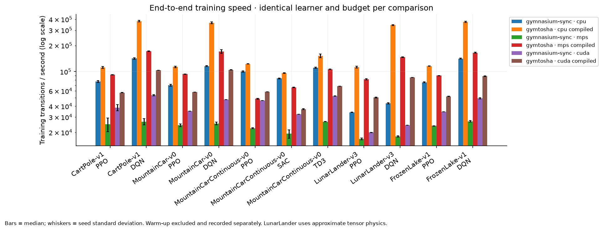
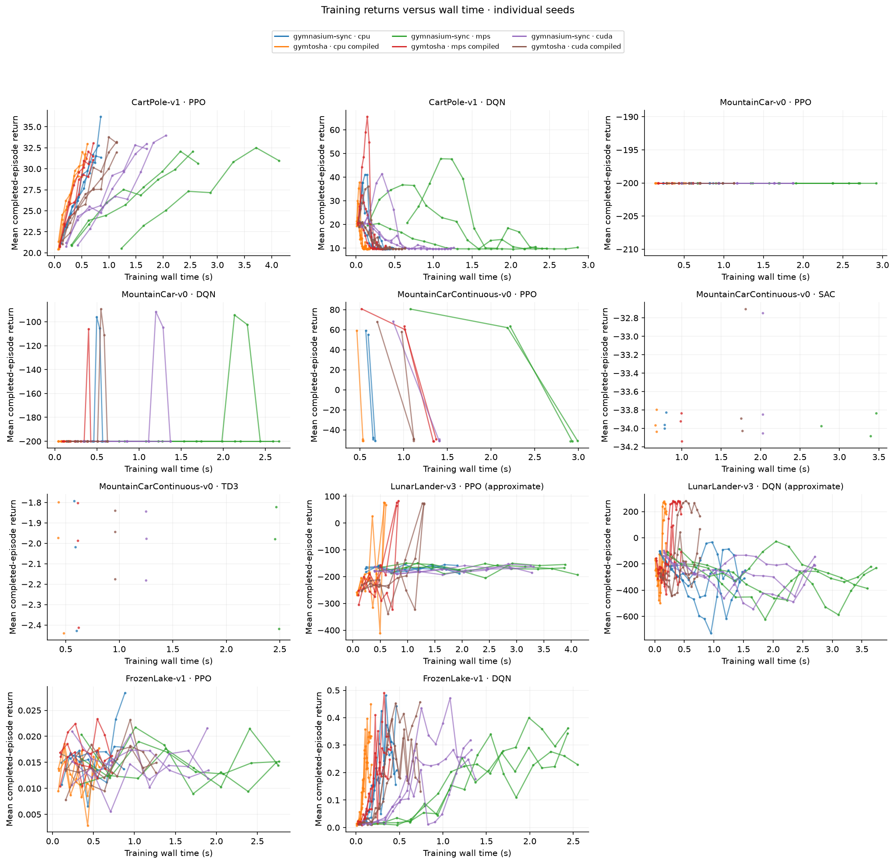
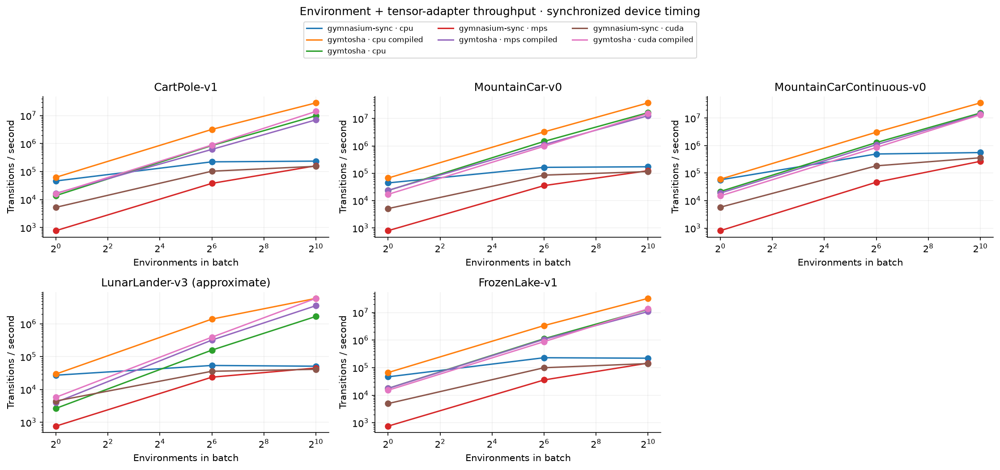

# GymTosha

[](https://tenor.com/view/naoya-hair-flip-meme-gif-10753964425195300606)

**GymTosha**는 투사주법(投射呪法, Tōsha Juhō)에서 이름을 가져온 배치형 강화학습 환경 라이브러리입니다.
하나의 PyTorch 상태 텐서에 모든 환경을 담고, 배치 전체의 전이·보상·종료·자동 초기화를 계산합니다.
CPU, CUDA, Apple MPS를 지정할 수 있고 `torch.compile(fullgraph=True)`을 지원합니다.

## 설치

Python 3.12 이상과 PyTorch 2.15 이상이 필요합니다. 저장소에서 설치할 수 있습니다.

```bash
uv sync --extra benchmark
uv run python examples/batched_cartpole.py
```

다른 프로젝트에서는 다음과 같이 설치합니다.

```bash
uv add /absolute/path/to/GymTosha
```

## 사용법

```python
import torch
import gymtosha

env = gymtosha.make("CartPole-v1", num_envs=4096, device="cuda").compile()
obs, info = env.reset(seed=42)

for _ in range(1000):
    actions = torch.randint(2, (env.num_envs,), device=env.device)
    obs, rewards, terminated, truncated, info = env.step(actions)

env.close()
```

GPU가 없는 시스템에서는 `device="cpu"`를 사용합니다. Apple GPU는 `device="mps"`입니다.
`compile()`의 첫 스텝에는 컴파일 시간이 포함됩니다. 이후 스텝은 생성된 커널을 재사용합니다.
환경별 컴파일 캐시를 분리하여 여러 env ID와 배치 크기를 한 프로세스에서 사용할 수 있습니다.
MPS의 큰 그래프는 Metal 버퍼 한도에 맞게 커널 융합 크기를 제한합니다.

## 환경

| env ID | 관측 배치 | 행동 배치 | 기본 제한 스텝 |
| --- | --- | --- | --- |
| `CartPole-v1` | `(N, 4)` float32 | `(N,)` int64 | 500 |
| `MountainCar-v0` | `(N, 2)` float32 | `(N,)` int64 | 200 |
| `MountainCarContinuous-v0` | `(N, 2)` float32 | `(N, 1)` float32 | 999 |
| `LunarLander-v3` | `(N, 8)` float32 | `(N,)` int64 | 1000 |
| `LunarLanderContinuous-v3` | `(N, 8)` float32 | `(N, 2)` float32 | 1000 |
| `FrozenLake-v1` | `(N,)` int64 | `(N,)` int64 | 100 |
| `FrozenLake8x8-v1` | `(N,)` int64 | `(N,)` int64 | 200 |

행동은 `single_action_space` 안의 유효한 값이어야 합니다. 연속 행동은 환경에서 경계로 자릅니다.
`single_observation_space`, `single_action_space`는 Gymnasium space이며,
`observation_space`, `action_space`는 배치 차원을 포함합니다.

CartPole과 MountainCar의 전이 수식, FrozenLake의 맵과 전이 확률은 Gymnasium을 따릅니다.
float32 계산과 독립 난수 생성기로 인해 Gymnasium과 seed를 같게 해도 같은 궤적을 보장하지 않습니다.
FrozenLake는 `is_slippery`, `map_name`, 문자열 행 목록 `desc`를 지원합니다.

**LunarLander는 근사 물리 환경입니다.** Gymnasium의 관측·행동 형식, 중력·추력,
지형 생성 방식과 보상 구조를 참고하며, 고정된 두 발과 텐서 기반 충돌 응답을 사용합니다.
Box2D의 관절·다리 스프링·접촉 해석과 궤적이 다르므로 LunarLander 속도 비교에는 물리 모델 차이도 포함됩니다.
`gravity`와 `continuous`를 지원합니다. 렌더링·바람 옵션은 초기 버전에 포함하지 않습니다.

## 초기화와 종료

기본값은 same-step 자동 초기화입니다. 종료된 행만 초기화되며 반환된 `obs`에는 새 에피소드의 관측이 들어갑니다.

- `terminated`, `truncated`, `rewards`는 `(N,)` 디바이스 텐서입니다.
- `info["final_observation"]`은 초기화 직전 관측입니다.
- `info["_final_observation"]`은 해당 행의 종료 여부입니다.
- `info["episode_return"]`, `info["episode_length"]`는 종료 직전까지 누적한 값입니다. 종료 마스크와 함께 읽습니다.
- 시간 제한은 `truncated`로 표시됩니다. 학습 시 실제 종료와 구분하여 마지막 관측의 가치를 부트스트랩합니다.

```python
mask = terminated | truncated
terminal_obs = info["final_observation"][mask]

# 일부 행을 수동으로 초기화
obs, _ = env.reset(options={"reset_mask": mask})
```

수동 종료 처리는 `autoreset=False`로 생성하고 종료 행에 `reset_mask`를 적용합니다.
난수 상태는 환경 배치가 소유하며 정책 학습의 전역 PyTorch 난수 상태를 변경하지 않습니다.
동일 디바이스·환경 설정·seed·행동 순서에서 재현됩니다.

## 학습과 성능 비교

CleanRL의 DQN·PPO·SAC·TD3를 배치 텐서 수집과 replay buffer에 맞춰 이식했습니다.
동일 학습 코드를 GymTosha, Gymnasium SyncVectorEnv, AsyncVectorEnv에 연결합니다.
PPO는 모든 환경, DQN은 이산 행동 환경, SAC·TD3는 연속 행동 환경에 적용합니다.
FrozenLake 관측은 학습기에서 one-hot으로 인코딩합니다. 출처와 변경 범위는 `THIRD_PARTY_NOTICES.md`에 있습니다.

```bash
# 다섯 환경, 호환되는 네 알고리즘, seed 세 개, CPU 비교
uv run --extra benchmark gymtosha-benchmark train --compile --output outputs/cpu

# 동일한 학습기로 CUDA에서 비교
uv run --extra benchmark gymtosha-benchmark train --device cuda --compile --output outputs/cuda

# 정책 추론·역전파를 제외한 환경 처리량 비교
uv run --extra benchmark gymtosha-benchmark throughput --device cuda --compile \
  --batch-sizes 1 64 1024 --output outputs/cuda-throughput

# 여러 측정 폴더의 그래프 합치기
uv run --extra benchmark gymtosha-benchmark plot --inputs outputs/cpu outputs/cuda \
  --output outputs/combined
```

`--backends gymnasium-sync gymnasium-async gymtosha`로 CPU 다중 프로세스 기준선을 추가할 수 있습니다.
`--append`는 기존 JSON 결과에 새 측정을 덧붙입니다. `--compile`은 GymTosha에만 적용됩니다.
샘플 예산과 업데이트 빈도는 두 백엔드에 동일하게 적용합니다.
PPO의 샘플 예산은 `num_envs × rollout_steps`의 배수여야 합니다.

결과 폴더에는 원시 JSON, 요약 CSV, PNG·SVG 그래프가 생성됩니다.
학습 처리량에는 정책 추론·환경 전이·replay/rollout·역전파·주기적 로깅이 포함됩니다.
환경 처리량 그래프에는 Gymnasium의 텐서 어댑터 변환도 포함됩니다.
환경·학습기 생성과 환경 커널 워밍업은 학습 처리량에서 제외합니다.
환경 생성과 커널 워밍업 시간은 별도로 기록합니다. GPU 시간은 디바이스를 동기화하여 측정합니다.
학습 곡선은 각 기록 구간에서 종료된 에피소드의 평균 리턴이며, 별도 평가 에피소드가 아닙니다.

### 실측 결과

Apple M3 Max의 CPU·MPS와 AMD Ryzen 5 5600X + NVIDIA RTX 3090의 CUDA에서 측정했습니다.
세 디바이스에서 학습 198회와 환경 처리량 315회를 실행했습니다.
실험 설정과 해석은 [측정 기록](benchmarks/results/README.md)에 정리했습니다.







## 개발과 배포 아티팩트

```bash
uv run ruff check .
uv run ruff format --check .
uv run pytest
uv build
```

GPU가 없는 환경에서는 accelerator 테스트를 건너뜁니다. 실제 GPU에서 실행하면
해당 장치의 CUDA·MPS 커널·자동 초기화·컴파일 경로도 검사합니다. CPU full-graph 테스트는 기본 테스트에 포함됩니다.
`uv build`는 설치 가능한 wheel과 sdist를 만듭니다.
