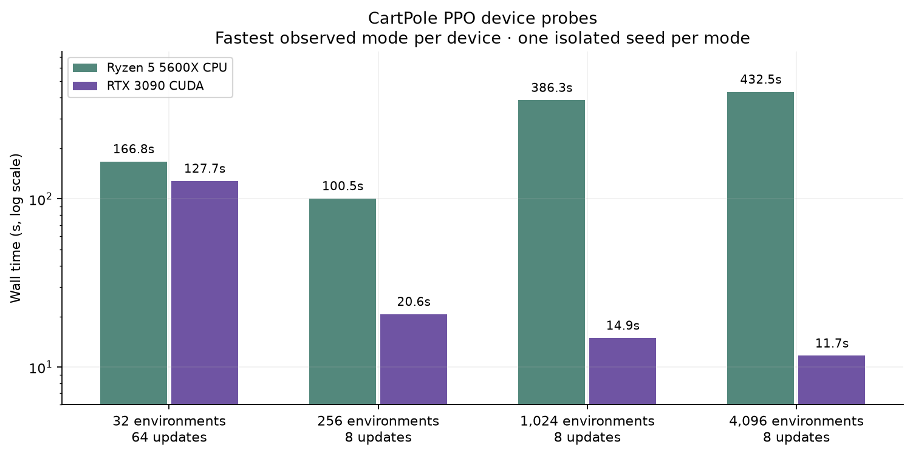

# CartPole PPO 정밀 실험

## 진행 상태

- [x] CartPole·PPO, 정책망과 가치망 256–256–256으로 범위 고정
- [x] Async 최대 32, 나머지 백엔드의 60초 기준 최대 환경 수 확인
- [ ] 환경 32개에서 한 파라미터씩 10개 시드로 탐색 중
- [ ] 환경 256, 1,024, 4,096개에서 스케일링 설정을 함께 탐색하고 나머지 환경 수의 설정을 계산
- [ ] 모든 백엔드의 환경 수별 20개 시드 비교
- [ ] 백엔드별 가장 효율적인 환경 수 비교

[최대 환경 수 결과와 히트맵](capacity/README.md)에서 현재 결과를 확인할 수 있습니다.
[실험 명세](../../../docs/CARTPOLE_STUDY.md)에 고정 학습 길이, 보상 통계와 안정적 도달 기준을 기록했습니다.

현재 완료된 용량 검증은 각 크기의 실행 가능 여부를 확인한 단일 실행입니다.
10개 시드의 평균·표준편차를 사용하는 하이퍼파라미터 실험을 진행 중입니다.
후보별 통계는 10개 시드가 모두 완료된 뒤 확정합니다.

대표 점수는 시드별로 계산한 별도 Gymnasium 평가의 마지막 5개 체크포인트 평균입니다.

## 기준점별 장치 검증

Ryzen 5 5600X와 RTX 3090에서 같은 환경 수와 PPO 설정을 CPU와 CUDA로 각각 실행했습니다.
시드 9001로 eager와 compiled를 한 번씩 측정하고, 각 환경 수에서 가장 짧은 시간을 낸
CUDA compiled를 선택했습니다. 32개는 rollout 업데이트 64회, 나머지 크기는 8회입니다.

[32개](device-probes/32.json) · [256개](device-probes/256.json) ·
[1,024개](device-probes/1024.json) · [4,096개](device-probes/4096.json)
