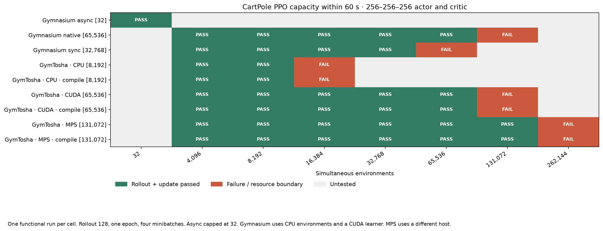

# CartPole PPO 최대 환경 수 검증

## 조건

정책망과 가치망은 각각 256–256–256이며 PPO rollout 128스텝을 수집하고
미니배치 4개로 한 epoch를 업데이트합니다. Gymnasium의 환경은 CPU에서, PPO 학습기는 CUDA에서 실행합니다. 손실이 유한하고 파라미터가 실제 변경되면 통과입니다.
Async는 상한 32를 적용했습니다. 다른 조건은 4,096개에서 시작해 두 배로 늘리며,
처음부터 실패하면 절반씩 줄입니다. 파일 한도와 프로세스 시작 방식은 바꾸지 않았습니다.

이는 단일 실행의 기능·자원 검증입니다. 학습 성능 평균과 표준편차를 산출한 실험이 아닙니다.
각 탐색 지점의 성공 여부를 표시하며 두 지점 사이의 정확한 경계는 측정하지 않았습니다.
검증 감시기는 가용 호스트 메모리가 1GiB 미만이 되거나 60초에 도달하면 해당 시도를 중단합니다.
아래 최대치는 이 검증 조건에서 확인한 최대입니다. 기존 기록은 측정된 경과 시간에 60초 기준을 적용해 재분류했고, 아직 측정하지 않았던 CUDA 조건은 새로 실행했습니다.

CPU·CUDA 및 Gymnasium은 Ryzen 5 5600X / RAM 32GB / RTX 3090 24GB 서버,
MPS는 Apple M3 Max / 통합 메모리 64GB에서 실행했습니다.

## 결과

| 백엔드 | 환경 / 학습 장치 | compile | 확인된 최대 환경 수 | 다음 실패 환경 수 | 실패 사유 |
| --- | --- | --- | --- | --- | --- |
| gymnasium-async | CPU / CUDA | 미적용 | 32 | — | 지정한 상한 32 |
| gymnasium-native | CPU / CUDA | 미적용 | 65,536 | 131,072 | CUDA 메모리 부족 |
| gymnasium-sync | CPU / CUDA | 미적용 | 32,768 | 65,536 | 60초 초과 |
| gymtosha | CPU | 미적용 | 8,192 | 16,384 | 60초 초과 |
| gymtosha | CPU | 적용 | 8,192 | 16,384 | 60초 초과 |
| gymtosha | CUDA | 미적용 | 65,536 | 131,072 | CUDA 메모리 부족 |
| gymtosha | CUDA | 적용 | 65,536 | 131,072 | CUDA 메모리 부족 |
| gymtosha | MPS | 미적용 | 131,072 | 262,144 | 가용 호스트 메모리 부족 |
| gymtosha | MPS | 적용 | 131,072 | 262,144 | MPS 텐서 크기 제한 |

각 조건의 `*-summary.json`에는 실제 시도 순서와 성공·실패 상세가 있습니다.
전체 설정과 시간은 개별 실행 JSON에 보존했습니다. 다음 단계의 하이퍼파라미터 탐색과
최종 비교는 고정 학습 길이와 조건별 20개 시드를 사용합니다.
