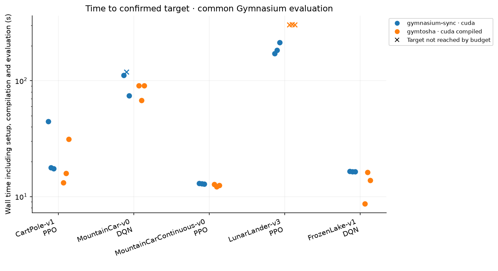
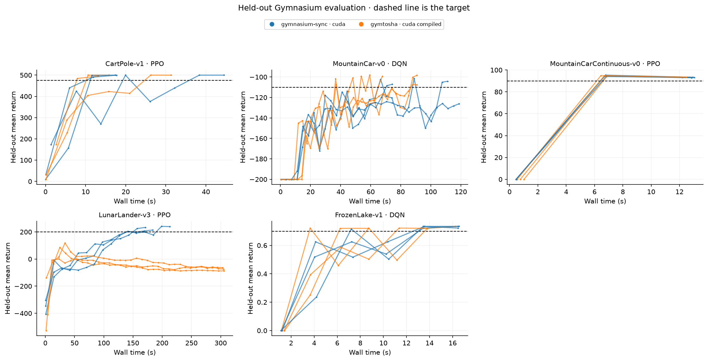

# 목표 성능 도달 시간 검증

## 조건

RTX 3090 24GB와 AMD Ryzen 5 5600X 서버에서 Python 3.12.12, PyTorch 2.15.0+cu132,
Gymnasium 1.4.0으로 측정했습니다. CPU 스레드는 하나이고 Triton FP fusion은 1입니다.

- 환경마다 대표 알고리즘 하나를 사용했습니다.
- Gymnasium에서 후보 네 개를 seed 101로 비교한 뒤 상위 두 후보를 seed 202로 확인했습니다.
- 탐색은 총 30회입니다. 평가 seed 900000을 사용했습니다.
- 선택한 설정을 고정하고 두 백엔드를 학습 seed 11·22·33으로 비교했습니다. 본 비교는 총 30회입니다.
- 본 비교의 평가 seed는 100000입니다. 두 정책 모두 별도의 Gymnasium 환경에서 평가했습니다.
- 평가는 100개 에피소드, FrozenLake는 1,000개 에피소드입니다. 연속 두 평가가 목표 이상이어야 달성입니다.
- 환경·모델 생성, 컴파일·워밍업, 학습과 평가를 포함한 wall time입니다. 프로세스 import 시간은 제외했습니다.
- 달성하지 못한 실행도 보존했습니다. 양쪽 모두 세 시드에서 달성한 환경만 대응 시드 시간비의 중앙값을 계산했습니다.

## 결과

시간 열은 세 시드 모두 목표를 달성한 경우의 중앙값입니다. `산정 보류`는 미달성 실행을
제외한 가속 배율을 만들지 않았다는 뜻입니다. 배율은 Gymnasium 시간 / GymTosha 시간입니다.

| 환경 | 학습기 | 목표 | Gymnasium 달성 | 시간(초) | GymTosha 달성 | 시간(초) | 대응 시드 배율 |
| --- | --- | --- | --- | --- | --- | --- | --- |
| CartPole-v1 | PPO | 475 | 3/3 | 17.75 | 3/3 | 15.86 | 1.12× |
| MountainCar-v0 | DQN | -110 | 2/3 | — | 3/3 | 90.79 | 산정 보류 |
| MountainCarContinuous-v0 | PPO | 90 | 3/3 | 12.95 | 3/3 | 12.50 | 1.03× |
| LunarLander-v3 | PPO | 200 | 3/3 | 183.70 | 0/3 | — | 산정 보류 |
| FrozenLake-v1 | DQN | 0.7 | 3/3 | 16.47 | 3/3 | 13.78 | 1.19× |





## 선택된 하이퍼파라미터

아래 설정은 실험한 후보 집합 안에서 선택했습니다. 무한한 하이퍼파라미터 공간의 전역 최적성을 뜻하지 않습니다.

| 환경 | 후보 | 학습률 | gamma | 병렬 환경 | rollout | PPO epoch | 탐험 행동 유지 | 관측·보상 정규화 |
| --- | --- | --- | --- | --- | --- | --- | --- | --- |
| CartPole-v1 | 2 | 0.0003 | 0.99 | 32 | 64 | 10 | 1 | 미적용 |
| MountainCar-v0 | 3 | 0.001 | 0.995 | 32 | — | — | 16 | 미적용 |
| MountainCarContinuous-v0 | 0 | 0.0003 | 0.99 | 32 | 64 | 10 | 1 | 적용 |
| LunarLander-v3 | 2 | 0.0003 | 0.99 | 16 | 128 | 10 | 1 | 적용 |
| FrozenLake-v1 | 0 | 0.001 | 0.99 | 64 | — | — | 1 | 미적용 |

각 후보의 설정, 성공 여부, 도달 시간과 평가 리턴은 `tuning_trials.json`에 있습니다.
선택된 전체 설정은 `selected_hyperparameters.json`에 있습니다. DQN은 replay batch 256을 사용합니다.
최대 transition 예산과 평가 주기는 각 실행의 config에 그대로 저장했습니다.

## 해석 범위

이 결과는 지정한 하드웨어·알고리즘·후보·학습 예산의 비교입니다. 시드별 성공 여부가 다르므로
단순 환경 처리량만으로 목표 성능 도달 시간의 향상을 판단하지 않습니다.
LunarLander의 GymTosha 학습 물리는 근사 모델입니다. 이 비교는 공통 Gymnasium 평가를
통과하는지를 검사하므로 자체 학습 환경의 높은 리턴만으로 성공 처리하지 않습니다.

LunarLander의 첫 번째 GymTosha 실행은 학습 환경에서 마지막 구간 평균 리턴 약 263을
기록했지만, 공통 Gymnasium 평가에서는 약 -63을 기록했습니다. 근사 물리에서 얻은
학습 성과가 원본 물리로 전이되지 않는 차이가 있으며, 동일 성능의 가속을 검증한 결과로
해석할 수 없습니다.

## 재현

```bash
uv sync --frozen --extra benchmark
TRITON_DEFAULT_FP_FUSION=1 uv run --extra benchmark gymtosha-benchmark time-to-target \
  --device cuda --presets benchmarks/results/time-to-target/selected_hyperparameters.json \
  --seeds 11 22 33 --output outputs/reproduction
```

원시 결과는 `time_to_target.json`, 행 단위 요약은 `time_to_target.csv`입니다.
`target_summary.json`과 `.csv`에 달성률과 대응 시드 비교가 있습니다.

## 코드와 설치 검증

최종 코드 검증에서 RTX 3090은 테스트 84개 통과·10개 건너뜀, Apple MPS는
85개 통과·9개 건너뜀을 기록했습니다. 장치별 실행 로그는 `pytest-cuda.txt`와
`pytest-mps.txt`에 있습니다. Ruff 검사·포맷 검사와 wheel·sdist 빌드도 통과했습니다.

저장소 밖의 독립 Python 3.12 환경에 공개 Git URL로 설치한 뒤 일곱 env ID의
생성·초기화·전이를 확인했습니다. 결과는 `install_verification.json`에 있습니다.
학습에 사용한 커밋과 최종 검증 커밋, 장치 정보는 `metadata.json`에 기록했습니다.
